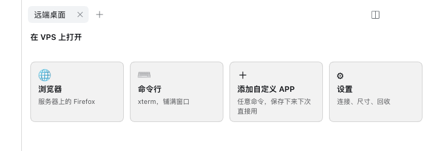
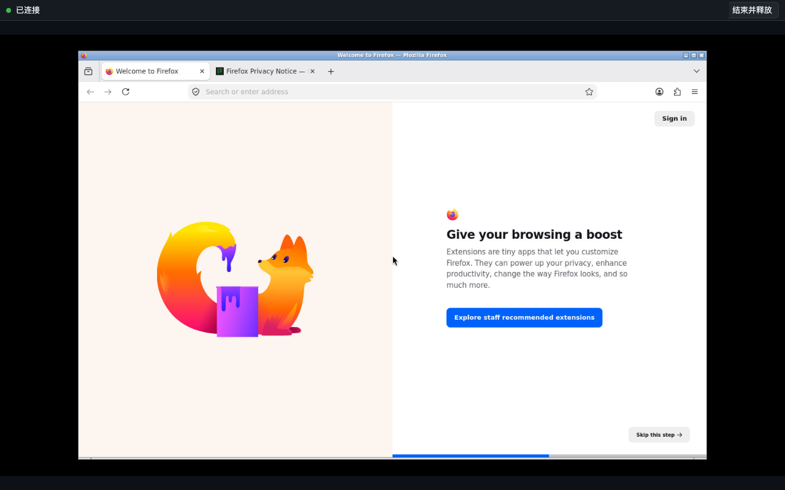

# FastVpsViewer

**English** | [中文](README.zh.md)

> Open an on-demand Openbox desktop from your own VPS inside the DSH right sidebar.

One SSH connection, zero public ports, and nothing to install on the remote host beyond TigerVNC and a window manager. Nothing runs remotely until you start a session, and everything is released when you stop, close, or go idle.

## Sound familiar?

You keep a VPS around for Claude Code / Codex — always on, always one SSH away. Every so often you need a browser window on it: a web console, a GUI-only tool, a page that refuses to render in a terminal.

Then the usual options:

- install a full desktop plus xrdp and watch a 1 vCPU / 1 GiB box run out of memory;
- add noVNC + guacd, which means another service, another port to maintain, and a real chance of exposing it by accident;
- open port 5900 for VNC, with passwords, firewall rules and attack surface to match.

When all you wanted was to look at something and click twice.

**FastVpsViewer is built for that "occasionally".** Nothing resident, no public port, no heavyweight stack: when you need it, it starts a tens-of-megabytes Openbox desktop on the VPS (TigerVNC ships its own X server, so no Xvfb), carries the framebuffer over the SSH connection you already have, and embeds it in the DSH right sidebar. Close it and the plugin runs `vncserver -kill`; the machine goes back to being a quiet terminal.





```
┌────────── local DSH ──────────┐        ┌────────── VPS ──────────┐
│ plugin host: state + ssh      │  ssh   │ Xtigervnc :N            │
│ local viewer: 127.0.0.1       │ ─────► │  └─ openbox             │
│ sidebar tab: noVNC canvas     │ tunnel │     (loopback only)     │
└───────────────────────────────┘        └─────────────────────────┘
```

## Remote requirements

On Debian / Ubuntu:

```sh
apt install -y tigervnc-standalone-server openbox
```

- `tigervnc-standalone-server` ships its own X server (Xtigervnc); **no Xvfb needed**.
- `openbox` is the default window manager and can be replaced through config.
- Passwordless SSH with a key must work. The plugin writes only `~/.fast-vps-viewer/xstartup.sh` on the remote host.

## Install

```sh
dsh plugin --profile desktop add github:SaltPlayingMaimai/FastVpsViewer
```

Or from a local checkout:

```sh
dsh plugin --profile desktop add /path/to/FastVpsViewer
```

Restart DSH Desktop completely afterwards. A **Remote desktop** entry appears in the right sidebar.

## Configuration

Override fields in your profile's `cordis.patch.yml` under `id: fast-vps-viewer`:

```yaml
- id: fast-vps-viewer
  config:
    sshHost: my-vps        # ~/.ssh/config alias, IP, or hostname
    sshPort: 22                   # port
    sshUser: ''                   # empty = ssh default
    auth: agent                   # agent | key | password
    identityFile: ''              # when auth=key, e.g. ~/.ssh/id_ed25519
    sshOptions: []                # extra ssh args
    display: 1                    # remote X display number
    vncPort: 5901                 # defaults to 5900 + display
    viewerPort: 19600             # local viewer port (falls back to +1, +2, …)
    geometry: 1600x900       # initial size; ignored once the viewer connects when autoResize is on
    autoResize: true         # desktop follows the panel size
    maximize: true           # launch windows maximized (openbox, private rc.xml)
    desktop: openbox
    startupCommands: ['browser']   # 'browser' picks firefox/firefox-esr/chromium/google-chrome/epiphany
    idleMinutes: 1                # fallback release if a close event is missed
    maxSessionMinutes: 120        # hard cap per session
    remoteIdleSeconds: 3600       # remote -MaxIdleTime safety net
```

### Change settings in the panel

The pane opens as a launcher: **Browser**, **Terminal** (a real SSH shell, not VNC), **Files**, **Add an app**, **Settings**. Pick a card; the browser path shows a loading animation while the session starts; saved apps show up under "My apps" for one-click starts.

The Browser card is not hardcoded to Firefox: it asks the server (`GET /api/browser`) which binary exists — first of firefox, firefox-esr, chromium, google-chrome, epiphany — and shows that name on the card. When it cannot tell yet, it says "Auto-picks Chrome or Firefox".

Press **Settings** at the top right of the sidebar pane to edit host / port / user / auth (agent, key file, password), the initial resolution, "fit the panel", "maximize windows", the programs launched on start, the idle timeout, and the session cap — plus a **Test** button that checks the connection before you start.

Saving writes `~/.dsh/fast-vps-viewer.json` (mode 600), which takes priority over the bundle config. If a session is running, press **Save & restart** to apply it now; otherwise it applies on the next start.

### Which auth mode?

| Option | What actually happens | When to use it |
|---|---|---|
| Use my ~/.ssh/config + agent (recommended) | The plugin runs exactly `ssh <host>`: `~/.ssh/config` (Host/User/Port/IdentityFile/ProxyJump) applies and ssh-agent keys are used. It adds `BatchMode=yes`, so it never prompts. | Your `ssh alias` already works in a terminal |
| Specific private key file | Adds `-i <file> -o IdentitiesOnly=yes -o PreferredAuthentications=publickey`, so a per-host default identity in the config is ignored. | Several keys; you want to pick one |
| Password | The stored password (0600, never returned by the API) is handed to ssh through `SSH_ASKPASS`. | The server only allows password login |

### The Terminal card is a real SSH shell, not VNC

It does not start a desktop: the card opens an xterm.js terminal connected straight to the server over `ssh -tt`, so there is no X server and no VNC to wait for — it is usually usable within a second.

- it is a **login shell**, so you get the usual `user@host:cwd#` prompt with your `PATH`, aliases and `~/.local/bin` loaded;
- the panel size becomes the PTY's cols/rows at open time (resizing the panel later does not change the remote PTY);
- closing the tab drops the SSH connection, leaving nothing behind;
- xterm.js is bundled (MIT, see `vendor/xterm/LICENSE`).

### Files

The launcher has a **Files** card: browse the remote tree (starts at `~`, bounded by `filesRoot`), download, delete, and upload.

- the top row is the path box: type `~/code` or `/var/log` and press Enter, next to Go / Upload / Up;
- every listing shows a loading indicator while the previous rows stay visible;
- paths are guarded: anything outside `filesRoot` (including `../../etc`) is rejected;
- Downloads use `GET /api/files/download`, deletes `POST /api/files/delete`, uploads `POST /api/upload`;
- one upload is capped at 512 MB;
- file operations share one persistent multiplexed SSH connection: the first listing takes 2–4 s, later ones are sub-second.

### Dropping files onto the desktop

While a session is open, drop local files onto the canvas. The plugin uploads them over SSH into `~/Downloads` on the VPS (configurable via `uploadDir`) and shows the resulting path.

This moves the file **to the server**; it does not click the browser's attach button for you. In the remote browser, open the file picker and choose the file from `Downloads`. VNC itself cannot carry files, so this is the shortest honest path.

## Resource release

| Layer | Trigger | Action |
|---|---|---|
| Close the tab | the ✕ on the sidebar tab | releases immediately: close tunnel + `vncserver -kill` |
| Disconnect fallback | last connection closed, `idleMinutes` elapsed (1 min) | automatic release (in case the close event never arrives) |
| Hard cap | session longer than `maxSessionMinutes` | automatic release |
| Remote watchdog | `remoteIdleSeconds` without input | Xtigervnc exits; `-autokill` cleans the session |
| Unload | plugin unloaded / DSH exits | disposer stops child processes and the local server |

Only processes this plugin started are ever killed: release targets the configured display with `vncserver -kill`, never a blanket `pkill`.

## Security

- VNC listens on remote `127.0.0.1` only, with `-SecurityTypes None`: it is reachable **only** through your SSH tunnel.
- The local viewer listens on `127.0.0.1` with a per-session random token; the control API checks Origin and accepts only the DSH application and loopback origins.
- No need to expose 5900 / 4822 / 3389, and no extra VNC password.

## Troubleshooting

| Symptom | Fix |
|---|---|
| “TigerVNC missing” | `apt install -y tigervnc-standalone-server openbox` on the VPS |
| `ssh failed` | make sure `ssh <alias>` works without a password prompt; the plugin runs with `BatchMode=yes` |
| Settings fail with `Unexpected token … is not valid JSON` | the host plugin is older than the UI (a client-only reload). Restart DSH Desktop completely; `/api/ping` now advertises `features` so a mismatched pair is detected and explained |
| The desktop is completely black | a window manager alone draws nothing. `startupCommands` defaults to `['browser']`; with no browser installed the reason lands in `~/.fast-vps-viewer/start.log` (`apt install firefox-esr`) |
| Port busy | `viewerPort` scans the next 20 ports; change `vncPort` if the remote port is taken |

## Limitations

- Linux remotes only (TigerVNC).
- No bidirectional clipboard, file transfer, audio, or multi-monitor.
- It **cannot** attach a file to a web page for you yet: dropping a file only uploads it to `~/Downloads` on the server. Doing the attach needs CDP or a browser extension; see `plan.md` §11.
- The client half depends on the DSH right-sidebar slots; without them it falls back to a button next to the composer.

## Development

```sh
node test/smoke.mjs   # starts a real session, checks HTTP/WebSocket/RFB, then releases it
```

## Docs

- [README](README.md) (English) / [README.zh.md](README.zh.md) (中文)
- [Plugin detail](docs/DETAIL.md) (English) / [DETAIL.zh.md](docs/DETAIL.zh.md) (中文)
- [plan.md](plan.md) and [handoff.md](handoff.md): developer notes in Chinese, each with an English abstract.

## License

MIT. Bundled noVNC is copyright its authors; see `vendor/novnc/LICENSE.txt`.
