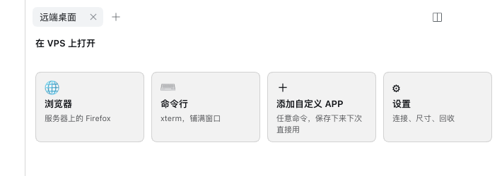
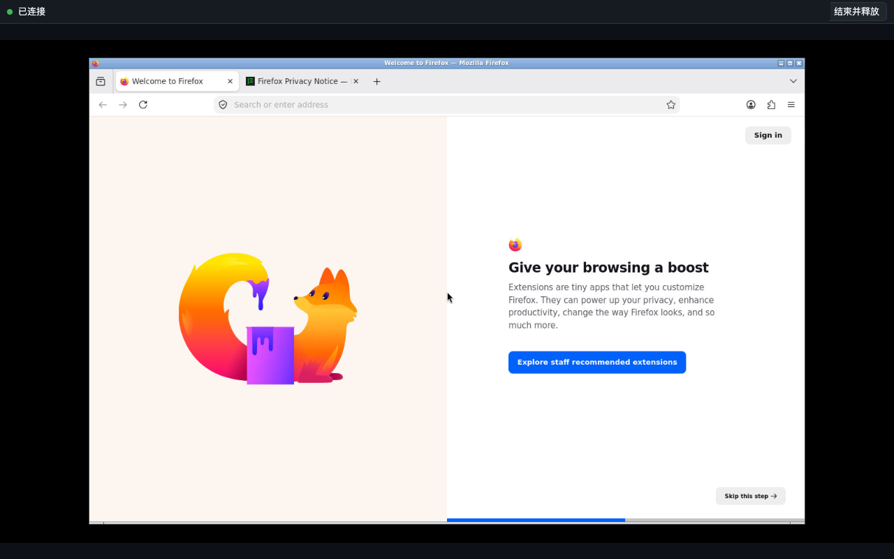

# FastVpsViewer

[English](README.md) | **中文**

> 在 DSH 右侧栏按需打开你自己 VPS 上的 Openbox 桌面 —— 默认直接给你一个浏览器。

一条 SSH 连接，零公网端口，远端不需要装 DSH、Node 或任何转发服务。不启动时远端不跑任何图形进程；结束、关掉、或者空闲之后自动释放。

## 这个场景你熟悉吗

你有一台 VPS，平时用来跑 Claude Code / Codex，随叫随到。可偶尔你就是需要在上头开个浏览器、点开某个网页后台，或者跑一个只有图形界面的小工具。

于是问题来了：

- 装一整套桌面环境 + xrdp，1 核 1G 的小机器直接被吃满；
- 上 noVNC + guacd，得再开一个服务、再维护一个端口，还得担心它裸奔在公网；
- 开个 5900 端口做 VNC，密码、防火墙、暴露面，一样都不能少。

而大多数时候，你只是想"看一眼、点几下"，然后关掉。

**FastVpsViewer 就是为这个"偶尔"做的。** 不常驻、不开公网端口、不装重型组件：要用的时候它在 VPS 上拉起一个几十 MB 的 Openbox 桌面（TigerVNC 自带 X server，连 Xvfb 都不用），顺着你已经在用的 SSH 连接把画面嵌进 DSH 右侧栏；你关掉页面，它 `vncserver -kill` 收干净，机器回到只剩终端的安静状态。





```
┌──────── 本地 DSH ────────┐        ┌──────── VPS ────────┐
│ 插件 host：状态机 + SSH   │  ssh   │ Xtigervnc :N        │
│ 本地 viewer：127.0.0.1   │ ─────► │  └─ openbox         │
│ 侧栏标签：noVNC 画面      │  隧道  │     (仅 127.0.0.1)  │
└──────────────────────────┘        └─────────────────────┘
```

## 远端要求

Debian / Ubuntu 上一行：

```sh
apt install -y tigervnc-standalone-server openbox
```

- `tigervnc-standalone-server` 自带 X server（Xtigervnc），**不需要 Xvfb**。
- `openbox` 是默认的窗口管理器，也可以用配置项换成别的。
- 远端 sshd 正常、你的 key 能免密登录即可。插件不会在远端安装任何自己的东西，只在 `~/.fast-vps-viewer/` 写一个 `xstartup.sh`。

## 安装

```sh
dsh plugin --profile desktop add github:SaltPlayingMaimai/FastVpsViewer
```

或者本地目录：

```sh
dsh plugin --profile desktop add /path/to/FastVpsViewer
```

装完**完整重启** DSH Desktop。侧栏右侧会出现「远端桌面」入口。

## 配置

装好后在 profile 的 `cordis.patch.yml` 里覆盖需要的字段（同名 `id: fast-vps-viewer` 的 `config`）：

```yaml
- id: fast-vps-viewer
  config:
    sshHost: my-vps        # ~/.ssh/config 里的别名，或 IP / 主机名
    sshPort: 22                   # 端口
    sshUser: ''                   # 用户名，留空用 ssh 默认
    auth: agent                   # agent | key | password
    identityFile: ''              # auth=key 时的私钥路径，例如 ~/.ssh/id_ed25519
    sshOptions: []                # 额外 ssh 参数
    display: 1                    # 远端 X display 号
    vncPort: 5901                 # 跟随 display 的默认端口
    viewerPort: 19600             # 本地 viewer 端口（占用时自动 +1 找空位）
    geometry: 1600x900            # 初始分辨率
    autoResize: true              # 桌面跟随面板大小
    desktop: openbox
    startupCommands: ['browser']  # 'browser' 自动挑浏览器；也可写 ['xterm', 'firefox https://example.com']
    idleMinutes: 5                # 无连接多久回收
    maxSessionMinutes: 120        # 单次会话硬上限
    remoteIdleSeconds: 3600       # 远端 -MaxIdleTime 兜底（无输入多久自毁）
```

### 在面板里改设置

面板打开就是一个启动器：**浏览器**、**命令行**（真 SSH 终端，不走 VNC）、**文件**、**添加自定义 APP**、**设置** 五张卡片，点哪张就按那个程序开会话；添加过的 APP 会留在「我的应用」里，下次一键启动。

「浏览器」卡片不是写死 Firefox：插件会先问一下服务器（`GET /api/browser`），按 firefox → firefox-esr → chromium → google-chrome → epiphany 的顺序挑第一个存在的，卡片上直接显示检测到的名字（例如「服务器上的 Chromium」）；没检测到时显示「自动选择 Chrome / Firefox」。

点右侧栏面板右上角的「设置」，可以直接改：SSH 主机/端口/用户名/认证方式（agent、私钥文件、密码）、初始分辨率、「跟随面板大小」、「窗口铺满桌面」、启动时运行的程序、空闲回收时间、单次会话上限，还能点「测试连接」先验一下。

保存后会写进 `~/.dsh/fast-vps-viewer.json`（权限 600），**优先级高于 bundle 里的配置**。如果会话正在运行，点「保存并重启会话」立刻生效；不点的话，下次启动会话时生效。

### 认证方式怎么选

| 选项 | 实际行为 | 什么时候用 |
|---|---|---|
| 跟随系统 ssh 配置（推荐） | 插件执行的就是 `ssh <主机>`，和你终端里一模一样：读 `~/.ssh/config` 的 Host/User/Port/IdentityFile/ProxyJump，用 ssh-agent 里已加载的密钥。为了不卡住，它加了 `BatchMode=yes`，**不会弹任何提示** | 你已经配好 `ssh 别名`，终端里能直接登 |
| 指定私钥文件 | 加 `-i <文件> -o IdentitiesOnly=yes -o PreferredAuthentications=publickey`，只用这一把钥匙，忽略 config 里的默认身份 | 多个 key、想明确指定用哪一个 |
| 密码 | 用 `SSH_ASKPASS` 把本机保存的密码交给 ssh；密码文件 0600，接口只回「是否已保存」 | 服务器只开了密码登录 |

### 命令行走的是真 SSH，不经过 VNC

「命令行」卡片不会拉起桌面：它打开一个 xterm.js 终端，直接通过 SSH 连到你的服务器（`ssh -tt`），所以**不用等 X 和 VNC 起来**，通常 1 秒内可用。

- 打开就是**登录 shell**，会显示 `user@host:cwd#` 这样的提示符，`PATH`、别名、`~/.local/bin` 都正常加载；
- 面板尺寸会换算成 PTY 的列/行（打开时确定，之后缩放面板不会改变远端 PTY 大小）；
- 关闭这个标签就断开 SSH，不留进程；
- 用的是内置的 xterm.js（MIT，见 `vendor/xterm/LICENSE`）。

### 文件

启动器里多了「文件」卡片：浏览远端目录（默认从 `~` 开始，可用 `filesRoot` 限定范围）、下载、删除、上传。

- 顶部那行就是路径栏：可以直接输入 `~/code`、`/var/log` 回车跳转，旁边还有「前往 / 上传 / 上一级」；
- 每次列目录都会显示加载指示，之前的列表保留在下面，不会闪成空白；
- 路径有护栏：只允许 `filesRoot` 之下，`../../etc` 之类会被拒绝；
- 下载走 `GET /api/files/download`，删除走 `POST /api/files/delete`，上传走 `POST /api/upload`；
- 上传单个文件上限 512 MB；
- 文件操作复用一条常驻的 SSH 多路连接，第一次列目录约 2–4 秒，之后是亚秒级。

### 把文件拖进画面

在已连接的面板里，把本地文件**拖到画面上松手**，插件会通过 SSH 把它传到远端的 `~/Downloads`（可用 `uploadDir` 改），右下角提示落到哪个路径。

注意这一步是「把文件送到服务器上」，**不是**替你在网页里点附件：接下来在远端浏览器的聊天框点上传/附件，文件选择框里选 `Downloads` 里那个文件即可。VNC 协议本身不传文件，所以这是能做到的最短路径。

## 资源释放

五层，任何一层生效都能把远端清干净：

| 层 | 触发 | 行为 |
|---|---|---|
| 关标签 | 点右侧栏标签上的 ✕ | 立刻释放：关隧道 + `vncserver -kill` |
| 断连兜底 | 最后一个连接断开 `idleMinutes` 后（默认 1 分钟） | 自动释放（关标签的事件没送到时的保险） |
| 上限 | 会话超过 `maxSessionMinutes` | 自动释放 |
| 远端兜底 | `remoteIdleSeconds` 无输入 | Xtigervnc 自行退出，`-autokill` 回收会话 |
| 卸载 | 插件卸载 / DSH 退出 | disposer 关闭子进程与本地服务 |

原则：**只杀自己拉起来的**。停止只对配置里的 display 执行 `vncserver -kill`，不会 `pkill` 任何东西。

## 安全

- VNC 只监听远端 `127.0.0.1`，并使用 `-SecurityTypes None`——它**只能**通过你的 SSH 隧道到达，公网无法连接。
- 本地 viewer 只监听 `127.0.0.1`，每次会话随机 token；control API 校验 Origin，只接受 DSH 应用与回环来源。
- 不需要把 5900 / 4822 / 3389 暴露出去，也不需要额外的 VNC 密码。

## 故障排查

| 现象 | 处理 |
|---|---|
| 启动失败，提示缺 TigerVNC | 在远端执行 `apt install -y tigervnc-standalone-server openbox` |
| `ssh 连接失败` | 先在终端里 `ssh <你的别名>` 确认免密登录；插件用 `BatchMode=yes`，不会弹密码 |
| 设置打不开，报 `Unexpected token … is not valid JSON` | 宿主插件比界面旧（比如只热更新了客户端）。完整重启 DSH Desktop；插件会通过 `/api/ping` 的 `features` 自动识别版本不匹配并给出提示 |
| 画面是全黑的 | 桌面只有窗口管理器、没有窗口。`startupCommands` 默认是 `['browser']`，远端若没有任何浏览器（`apt install firefox-esr`），会写进 `~/.fast-vps-viewer/start.log` |
| 端口被占 | `viewerPort` 会自动向后找 20 个端口；远端端口可用 `vncPort` 改 |
| 断线 | 页面点「重新连接」；会话仍然闲置的话会被回收 |

## 已知限制

- 只支持 Linux 远端（TigerVNC）。
- 不做剪贴板双向、文件传输、音频、多显示器。
- 目前**不能**把文件自动塞进网页的附件框：拖进画面只是把文件传到服务器 `~/Downloads`。要"点一下就附加"需要 CDP 或浏览器扩展，设计在 `plan.md` §11。
- client 半边依赖 DSH 的右侧栏槽位；如果你的 DSH 版本没有开放，会降级成输入框旁的一个按钮。

## 开发

```sh
node test/smoke.mjs            # 起真实会话，验证 HTTP / WebSocket / RFB 握手，再释放
```

仓库结构：

```
index.js            host 半边：状态机、SSH、本地 HTTP+WebSocket
client.js           client 半边：右侧栏标签 / 降级按钮
viewer/             viewer 页面（noVNC 播放器）
vendor/novnc/       内置的 noVNC 1.6.0（MIT）
plan.md             设计与实施计划
handoff.md          交接说明
```

## 文档

- [README.zh.md](README.zh.md)（中文） / [README.md](README.md)（English）
- [插件详情](docs/DETAIL.zh.md)（中文） / [DETAIL.md](docs/DETAIL.md)（English）
- [plan.md](plan.md) 与 [handoff.md](handoff.md)：中文开发笔记，各带一段英文摘要。

## 许可

MIT。内置的 noVNC 版权归其作者所有，见 `vendor/novnc/LICENSE.txt`。
